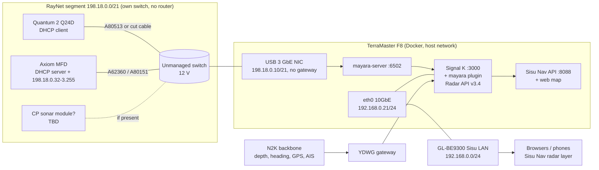

# Raymarine Axiom — Sisu Nav takeover plan

**Status:** plan, nothing built. Reviewed 2026-10-19 (radar edge box, Freeboard-SK first, sonar routes S1–S3). **Date:** 2026-10-19.
**Why:** Sisu Nav on the F8 already shows Sisu's charts. What it lacks to stand in for the Raymarine Axiom chartplotter is radar and sonar. Radar can be read with open-source software. Sonar cannot.
**Goal:** make **Sisu Nav (F8, Docker) the primary chart, instrument and radar display**, using **mayara-server + the Signal K Radar API + a MapLibre radar layer**. The Axiom stays aboard, at least as the sonar display and as the fallback. Whether it can ever come out depends on the answers in §6.

**Source:** desk research on 2026-10-19 (links in *Sources*). Nothing has been tested on Sisu yet. **UNVERIFIED** marks anything not confirmed from a primary source or on the boat. **TBD (survey)** marks facts only Sisu's own hardware can answer (§0).

Related: [`NETWORK.md`](../../NETWORK.md) (Sisu LAN, GL-BE9300, F8 at 192.168.0.21), [`sisu-nav/DESIGN.md`](../../sisu-nav/DESIGN.md), [`sisu-nav/web/src/plugins/`](../../sisu-nav/web/src/plugins/) (overlay plugins), [`homeassistant/docker-compose.yml`](../../homeassistant/docker-compose.yml) (Signal K on the F8, `network_mode: host`).

### Review 2026-10-19: what changes

A second research pass changed these points. Details are in the sections named.

1. **Radar on a chart with zero code first.** Freeboard-SK 3.0.1 is already installed on the F8's Signal K and draws the Signal K Radar API (MaYaRa) as an overlay. Use it as the first radar display (new Phase 3b) and build the Sisu Nav layer after that, copying what works (§2.3).
2. **A 12 V radar/sonar edge box instead of a USB NIC on the F8.** A small Linux computer on 12 V with two Ethernet ports sits on RayNet and the Sisu LAN. It runs mayara and the sonar capture and feeds Signal K on the F8. This removes the two biggest unknowns: TOS USB NIC drivers, and radar going dark when the inverter is off (§3.2, §7.4). This is now the recommendation; the F8 USB NIC (option A) stays as the cheaper alternative.
3. **Sonar is no longer "Axiom only".** There are three routes, and they can be combined (§2.4):
   - **S1, the Axiom's real sonar picture inside Sisu Nav:** screen capture. Axiom/Axiom Pro use Miracast into a certified receiver plus HDMI capture; Axiom XL/2 Pro use HDMI capture directly. Streamed to the browser with go2rtc.
   - **S2, Sisu's own echosounder with an open protocol:** a second, small transducer (Cerulean S500 CHIRP or Blue Robotics Ping2), its own waterfall in Sisu Nav, and depth into Signal K as a second source.
   - **S3, decoding the RayNet sonar stream:** still unsolved upstream. Watch Sailing Exodus's series, but don't build on it.
4. **Facts checked on 2026-10-19:**
   - Signal K on the F8 is **2.32.0**, which meets the mayara plugin's ≥ 2.31.0 (§0.6 done).
   - Sisu Nav's MapLibre is now **6.15** (#207). Its worker setup (`setWorkerUrl`) also applies to the radar custom layer (§4.3).
5. **Security from day one (new §8.1):** mayara's GUI (:6502) and go2rtc (:1984) have no login by default. Only the F8 may reach them (admin via SSH tunnel), pin their images by digest, and run cyber-check before going live.

---

## 0. Do now, before anything else

1. **Read the radar label.** We need the part number. `E70498` / `E70498-B` is the Quantum 2 Doppler Q24D. `T70417` is that radar bundled with 15 m power and data cables. Also record the radar's software version (Axiom: *Settings → Network → Radar*, **UNVERIFIED** menu path).
2. **Identify the chartplotter.** Record the model (Axiom / Axiom+ / Axiom 2 Pro / XL), the LightHouse version and how many RayNet ports it has. An Axiom 2 Pro adds a micro-HDMI output, which matters for the sonar-mirroring option in §2.4.
3. **Trace the radar link.** Is the radar wired over RayNet, or linked to the Axiom over Wi-Fi? Photograph the back of the Axiom and every RayNet connector, plus the Quantum's base connector (data and power separate, or through the A80308 Y-adapter).
4. **Identify the sonar.** It is either built into the Axiom (a "RV" or "S" variant, **UNVERIFIED** naming on Sisu's unit) or a separate CP-series module (CP100/CP200/CP370/CP470/CP570). Also record the transducer model.
5. **List everything else the Axiom does today:** autopilot control (Evolution?), AIS display, alarms, camera feeds, YachtSense, the Raymarine app. Anything on that list that Sisu Nav does not cover keeps the Axiom aboard.
6. ~~Check the Signal K server version on the F8.~~ **Done 2026-10-19:** Signal K **2.32.0** (`GET :3000/signalk`), which meets the plugin's stricter requirement (≥ 2.31.0 on npm, vs ≥ 2.24.0 in its README).
7. **For sonar route S1:** photograph the Axiom's back panel (is there a micro-HDMI port?) and check *Settings → Wireless connections* for "Wireless display" / Miracast (**UNVERIFIED** menu path).
8. **For sonar route S2:** the hull at the bilge/keel area: material (solid GRP, cored?), a dry spot inside for a small through-hull or in-hull transducer, and how far that is from the existing transducer.

---

## 1. The Axiom setup as built (as far as known)

### 1.1 Today

```
Quantum 2 radome ──RayNet (and/or Wi-Fi)──► Axiom MFD ◄──analog── sonar transducer (or via CP module on RayNet)
   │ separate 12 V power                     │
                                             └──SeaTalkNG / N2K──► backbone ──► YDWG gateway ──► Signal K (F8)
Sisu LAN 192.168.0.0/24 (GL-BE9300): F8 192.168.0.21 runs Signal K :3000, Sisu Nav :8088, Grafana, Influx
```

- **RayNet** is 100 Mbit/s Ethernet in a waterproof twist-lock connector. Raymarine runs it as a private network, **198.18.0.0/21** (netmask 255.255.248.0). The Axiom (LightHouse 3/4) acts as DHCP server **and** gives itself an address in **198.18.0.32–198.18.3.255**. Nothing else may take a fixed address in that range. Third-party fixed addresses belong in **198.18.0.2–198.18.0.19**. A third-party DHCP server must hand out **198.18.4.0–198.18.7.254**, and its own address must be exactly 198.18.0.1 (Raymarine 81411; mayara Raymarine guide).
- **Quantum networking:** the Quantum is a DHCP client and stays silent until it gets a lease. Inside the dome, the spinning part talks to the base over 2.4 GHz Wi-Fi even on a wired install, so 2.4 GHz congestion can drop radar image data (mayara guide).
- **Radar traffic is multicast:** discovery on `224.0.0.1:5800` (wired) and `232.1.1.1:5800` (Wi-Fi); reports and image data on `232.1.x.x:2574`. Controls go unicast to the radar's own address. Quantum image data is run-length compressed: **250 spokes per turn, up to 252 samples each, ≈0.06 MB per turn** (mayara networking help; Sailing Exodus measured ~6 kB/s on open water).
- **Sonar:** the transducer is analog (transmit pulses, echoes). The Axiom or a CP module processes it. Processed sonar on RayNet is a proprietary multicast stream (Sailing Exodus: `226.x.x.x:3221`, ~157 kB/s, 71 pings/s, **only while a sonar page is open on the MFD**).
- **Instruments:** depth, heading, position, wind and so on are already on NMEA 2000 → Signal K, so they do not depend on the Axiom.

### 1.2 Axiom roles and who takes them over

| Axiom role | Sisu Nav replacement | Status | Axiom still needed? |
|---|---|---|---|
| Charts | Sisu Nav MBTiles (satellite + nautical, 2,215 sets) | **Done** | No |
| Instruments (depth, wind, SOG/COG, heading) | N2K → Signal K → `plugins/instruments` | **Done** | No |
| AIS targets | Signal K AIS → Sisu Nav (already shown, **UNVERIFIED** for every class) | Mostly done | No |
| Radar display + control | mayara-server → Signal K Radar API → `plugins/radar` (new) | **Feasible**, §2.2 | Only if the radar stays on Wi-Fi to the Axiom, or as RayNet DHCP server (§3.2) |
| Doppler colouring, ARPA/MARPA | mayara (Doppler listed for Quantum 24D; ARPA with CPA/TCPA) | Feasible, **UNVERIFIED on Sisu** | No |
| Sonar / fishfinder image | S1: Axiom screen captured into a Sisu Nav panel · S2: own echosounder + waterfall in Sisu Nav (§2.4) | S1 feasible (Axiom stays the sonar head) · S2 feasible, own hardware · RayNet decode: **unsolved** | S1: **yes** · S2: no |
| Depth number | N2K depth PGN → Signal K | Done | No |
| Autopilot control, alarms, cameras | out of scope here | TBD (survey, §0.5) | TBD |
| Radar software updates and Wi-Fi pairing | Raymarine-only | — | **Yes** (occasionally) |

**Honest verdict:** Sisu Nav can take over **charts, instruments and radar**. For sonar it can **show** the Axiom's real picture (S1) and add **its own** echosounder (S2), but it cannot decode Raymarine's sonar itself. The Axiom stays as the Raymarine sonar head and as a backup radar display. For now it also stays as the RayNet DHCP server, which is the lowest-risk network setup (§3.2).

---

## 2. Each role: how

### 2.1 Charts and instruments
Already live. Nothing to build. One possible extra: Signal K alarms (shallow water, anchor) shown in Sisu Nav, so the Axiom's alarm screens are not the only ones.

### 2.2 Radar: mayara-server (recommended)

- **mayara-server** (Rust, Apache-2.0, by Kees Verruijt, the radar_pi maintainer). Latest is **v3.14.0, 2026-10-09**, and it is under daily development. It turns each brand's proprietary radar protocol into the open **Signal K Radar API**: REST for controls and **WebSocket for spokes (binary protobuf)**. Its built-in GUI runs in a web browser, which shows the stream works in browsers.
- **Raymarine support:** README lists *Quantum, RD series, HD radomes* as "fully supported and tested with real hardware". Its Raymarine guide lists **Quantum 2 Q24D = Doppler: yes**. Since v3.7.0 it wakes a wired Quantum itself, so **no MFD is required on a wired setup, but a DHCP server is**.
- **Wired vs Wi-Fi** (mayara guide):

| Setup | Works | Axiom must stay on |
|---|---|---|
| mayara wired to RayNet, radar wired to RayNet | Yes | No (needs some DHCP server) |
| mayara wired to RayNet, radar on Wi-Fi to the Axiom | Yes, the Axiom bridges it | **Yes** |
| mayara on the Axiom's Wi-Fi (`--allow-wifi`) | Yes | **Yes**. Not recommended: Wi-Fi multicast drops spokes |

- **Deployment:** Docker image `ghcr.io/marineyachtradar/mayara-server` with `--net=host` (needed to receive multicast), or the static `x86_64-unknown-linux-musl` binary. The F8 is an x86_64 Intel i3-N305, so either works. Built-in GUI on port **6502**.
- **OpenCPN radar_pi** is *not* the route. It is a desktop plugin, its last release (v5.5.0-beta) is from March 2023, and in issue #272 (Quantum 2 Q24D + Axiom) the Quantum was only found while the Axiom was on. The same maintainers have moved to mayara.
- **Other decoders:** Sailing Exodus documents the Quantum's spoke format (20-byte header, `0x5c` run-length escape, codec "not fully pinned down"). KAHU `radar_receiver` (Node binding of radar_pi) is dead (radar_pi #278). Neither is needed.

### 2.3 Radar → Signal K → Sisu Nav

- **Signal K Radar API v3.4.0** (in signalk-server). mayara is the reference provider. Endpoints under `/signalk/v2/api/vessels/self/radars`: list, `/{id}/capabilities`, `/{id}/controls/{cid}` GET/PUT, `/{id}/targets`, and **`/{id}/spokes` (WebSocket, binary)**. Control and target updates also arrive on `/signalk/v1/stream`.
- **Plugin:** `@marineyachtradar/signalk-plugin` **v1.8.0 (2026-10-11)**, MIT. It registers mayara as the Radar API provider and forwards spokes through Signal K's `binaryStreamManager`. It can manage the mayara container itself through `signalk-container` (Podman/Docker). On the F8 we would rather run mayara from our own compose file and point the plugin at it. Whether the plugin accepts an external mayara URL is **UNVERIFIED**. Check its config schema.
- **Why go through Signal K and not straight to mayara:** Sisu Nav already authenticates to Signal K (`web/src/app/sk.ts`, `api/signalk-session.mjs`), phones on the Sisu LAN already reach `:3000` through the GL-BE9300 firewall (`NETWORK.md` §4), and Signal K stays the single source. Browsers never talk to mayara directly (§8.1).
- **Existing clients worth copying:** Freeboard-SK (Signal K chart plotter with radar overlay), Binnacle (`NearlCrews/signalk-binnacle`, WebGL Signal K chart plotter with radar), mayara_pi (OpenCPN).
- **Freeboard-SK first (zero code).** Freeboard-SK **3.0.1** is already installed on the F8's Signal K (`homeassistant/signalk/package.json`, served at `http://192.168.0.21:3000/@signalk/freeboard-sk/`). Its help says it "supports the Signal K RADAR API" through MaYaRa, with a radar button that appears once a radar is detected. As soon as mayara and its plugin run (Phase 3), the radar is on a chart in Freeboard-SK, with nothing built. That gives a working display at sea while the Sisu Nav layer is written, plus a reference for how alignment, palettes and controls should behave. Which Freeboard-SK version first added radar is **UNVERIFIED**; its 3.0.1 bundle contains radar code.

### 2.4 Sonar: three routes

**Where things stand (2026-10-19).** Raymarine sonar on RayNet (CHIRP, ClearPulse, DownVision, SideVision, RealVision 3D) has no open decoder. Sailing Exodus has decoded the fishfinder stream's header (`226.x.x.x:3221`, ~157 kB/s, 71 pings/s): header length, packet length, ping counter, channel name such as "Auto (50/200kHz)", and the settings block. The header layout shifts when a setting changes, and where the echo samples start and how they scale is "inferred, not proven". The stream also exists only while a sonar page is open on an MFD. Their summary: "Radar had a champion. Sonar didn't." They have announced a sonar episode in their boat-computer video series (radar episode published 2026-10-16), so check it before Phase 6, but don't plan on it.

So sonar takes three routes, and they can be combined:

#### S1. The Axiom's real sonar picture inside Sisu Nav (screen capture)

The Axiom keeps processing the transducer. Sisu Nav shows its screen as live video in a panel. You get the full Raymarine picture (CHIRP, DownVision, RealVision) with nothing decoded.

| Axiom model | Video path | Parts |
|---|---|---|
| Axiom / Axiom Pro (LightHouse 3.2.86+) | **Miracast** to a Wi-Fi-Alliance-certified Miracast receiver with HDMI out, then a USB HDMI capture stick | certified Miracast receiver (Raymarine staff warn that cheap generic dongles are unreliable) + UVC HDMI capture stick |
| Axiom XL / Axiom 2 Pro | **HDMI out** (Axiom 2 Pro: micro-HDMI, cable `A80723`) into a USB HDMI capture stick | capture stick (+ A80723 on 2 Pro) |
| Axiom+ | Miracast **UNVERIFIED** (the 2018 posts name only Axiom and Axiom Pro) | check in §0.7 |

- **Stream to the browser:** the capture stick is a plain UVC webcam. **go2rtc** (Docker, `ffmpeg:` device source) turns it into **MSE over WebSocket** (WebRTC media would need UDP/TCP 8555 straight to the browser, which §8.1 blocks). The Sisu Nav API proxies the WebSocket (new `api/video/` route, authenticated like the rest of `:8088`), and a new Sisu Nav panel plugin plays it. Browsers never reach go2rtc directly (§8.1). Latency for a capture stick through go2rtc is **UNVERIFIED** (go2rtc advertises near-zero delay for many sources).
- **Why not receive Miracast in software on Linux:** lazycast and MiracleCast exist, but they're finicky and largely unmaintained (2026 reports). A hardware receiver plus a capture stick are each a commodity part and easy to swap.
- **Limits:**
  - You see whatever page the Axiom shows. Set up a dedicated sonar split page on the Axiom.
  - Sisu Nav can't control the Axiom. Use the Raymarine app or the Axiom itself for gain and range.
  - The Axiom must be on.
  - Forum users report long Miracast sessions dropping. The HDMI models don't have that problem.

#### S2. Sisu's own echosounder (open protocol, own waterfall)

Add a **second, small transducer** whose data we fully own. Sisu Nav draws its own waterfall (an echogram, depth against time), and the depth goes into Signal K as a second source. It works with the Axiom off, and later on the edge box (§3.2) with no Axiom at all.

| Option | What it is | Data | Fit for Sisu |
|---|---|---|---|
| **Cerulean Sonar S500** (also sold through Blue Robotics, **UNVERIFIED**) | CHIRP single-beam, 500 kHz, **5° beam**, 0.3 m to >100 m, 10–30 V, 2.5–5 W; transducer separate from the electronics board | full signal profile for a waterfall + distance; Ethernet/USB/serial (protocol details **UNVERIFIED**, the Ping protocol family is likely) | **Best candidate.** The narrow beam gives a clean bottom trace, and >100 m covers anchoring and coastal work. Price: $595 on a 2020 slide, current price **UNVERIFIED** |
| **Blue Robotics Ping2** | single-beam, 115 kHz, 25° beam, 0.3–100 m, 5 V TTL serial | **documented open Ping protocol**: distance (mm), confidence (%), `profile_data` of ~200 intensity samples between scan start and length; Python `brping` library | **Cheapest, fully documented.** Wide beam, low resolution. 115 kHz was chosen to keep away from 50/200 kHz boat sounders |
| **Open Echo** (`Neumi/open_echo`) | TUSS4470 shield on an Arduino (an STM32 all-in-one board is in development) driving a **real marine transducer** (Raymarine CPT-S 50/200 kHz tested) | raw echo, NMEA 0183 depth, own waterfall | **Experiment.** Not calibrated. Interesting because it can drive a proper marine transducer |

Integration (S500 or Ping2):
- Sensor (USB/serial or Ethernet) → small service on the edge box or the F8 (Python `brping`, or a Node port) → **Signal K**: depth under its own `$source`, published as `environment.depth.belowTransducer` **with its own transducer offset** (and `belowKeel` / `belowSurface` once the offsets are measured), as a second source (source priority per `.ai_context/sources.md`, rule 11: the instrument N2K depth stays first). The waterfall goes as a binary stream, over a Signal K binary stream like the radar's or over a small WebSocket.
- Sisu Nav **`plugins/sonar/`**: a waterfall panel on a canvas: one column per ping, colour by intensity, a depth scale from scan start and length, a bottom line from `distance` + `confidence`.
- **Mounting:** a small through-hull fairing block, or an in-hull mount for a solid GRP hull (an oil- or water-filled tube; whether the S500 or Ping2 frequency shoots through Sisu's laminate is **UNVERIFIED**). Haul-out vs in-hull is a §7 question.
- **Interference:** run it at a frequency away from the Axiom's 50/200 kHz (S500 500 kHz, Ping2 115 kHz). Check for cross-talk at the dock with both running.
- **Not a navigation instrument** until it has tracked the N2K depth for a season.

#### S3. Decode the RayNet sonar stream (research, not planned)

This would replace S1's video with real data, but the format is unsolved, it needs an MFD sonar page open anyway, and each Raymarine model differs. If Sailing Exodus or someone else publishes a decoder, re-evaluate. Capturing a few minutes of the stream at the dock (with the mayara network setup in place) costs little and could help them.

| Route | Picture | Needs the Axiom on | Cost | Recommendation |
|---|---|---|---|---|
| N2K depth (have it) | number, alarm, history | no | none | keep |
| Raymarine app mirroring | real sonar on a phone/tablet | yes | none | use now |
| **S1** screen capture into Sisu Nav | real Raymarine sonar in Sisu Nav | yes | receiver + capture stick, a few hundred USD (**UNVERIFIED**) | **do first** |
| **S2** own echosounder | own waterfall + 2nd depth | no | sensor + mounting + haul-out or in-hull work | **do second** |
| S3 RayNet decode | real data | yes | research time | watch only |

---

## 3. Hardware and network

### 3.1 Target architecture



With the **edge box (§3.2 option C)**, the `F8` subgraph's NIC2 and `mayara-server` move to the edge box. The edge box's LAN port reaches Signal K on the F8, and the S1 capture stick and the S2 sensor plug into the edge box.

### 3.2 Network design

- **Keep RayNet and the Sisu LAN apart.** Plugging RayNet straight into the GL-BE9300 would put two DHCP servers (the Axiom and the router) on one segment, and the radar could end up on the wrong one. RayNet stays its own Layer-2 segment and the F8 joins it through a **second interface**.
- **F8 second interface.** The F8 SSD Plus has **one** RJ-45 10GbE port (eth0, 192.168.0.21/24, checked on the box 2026-10-19) and **three USB 3.2 Gen 2 ports** (2× A, 1× C), with no PCIe slot. Two ways:
  - **A (alternative, cheapest): USB 3 Gigabit Ethernet adapter** dedicated to RayNet. Whether TOS has a driver for common chipsets (RTL8153, AX88179) is **UNVERIFIED**. Test before relying on it. Whether the setting survives TOS updates is **UNVERIFIED**.
  - **B: VLAN** on a managed switch with a tagged sub-interface on eth0. Fewer parts, but IGMP snooping on the managed switch is the most likely cause of "radar found, no image" on 232.x groups, and the GL-BE9300 would need its VLAN set up so it does not route or DHCP that VLAN. Use only if A fails.
  - **C (recommended): a 12 V edge box.** A small Linux computer (Raspberry Pi 5 with a USB 3 GbE adapter, or a fanless N100-class mini PC with two Ethernet ports) on a fused 12 V feed:
    - **NIC 1** on RayNet: 198.18.0.10/21, no gateway, same rules as A.
    - **NIC 2** on the Sisu LAN.
    - It runs **mayara**, the **S2 sonar service** and **go2rtc for S1** (the capture stick plugs in here).
    - It feeds Signal K on the F8 over the LAN: the mayara plugin points at the edge box.

    Why it's better than A:
    - no dependency on TOS USB drivers;
    - RayNet multicast never touches the F8;
    - radar and sonar keep running on 12 V with the inverter off (the F8 is AC-powered, §7.4);
    - it can later be the RayNet DHCP server for Phase 5 without touching the NAS.

    Cost: one more box to keep updated (pinned images, cyber-check). Sailing Exodus runs Quantum radar on a ~$150 Raspberry Pi.

    Is a Pi 5's USB NIC fast enough? Quantum is only ~6 kB/s, so yes in principle, but sustained multicast on the Pi's USB NIC is **UNVERIFIED**; the N100 box with two built-in NICs avoids that question.
- **Addressing, with the Axiom staying as DHCP server (recommended):** give the RayNet interface (edge box, or the F8 under option A) a **fixed 198.18.0.10/21** (anything in 198.18.0.2–.19), **no default gateway, no DNS**, so the F8's internet route stays on eth0. Never use 198.18.0.32–198.18.3.255. Pass `-i <raynet-iface>` to mayara so it does not listen on eth0.
- **Addressing, if the radar must work with the Axiom off:** run `dnsmasq` (or isc-dhcp-server) on the F8's RayNet interface, server address **198.18.0.1**, pool **198.18.4.0–198.18.7.254**, short lease. **This conflicts with the Axiom's own DHCP server.** Raymarine's options are "Raymarine device as sole DHCP server" or carefully split ranges (81411). Users in radar_pi #272 used short leases and switched their server off before powering the Axiom. Treat this as Phase 5, only after testing at the dock. Turning DHCP off on the Axiom (diagnostics menu) is **UNVERIFIED**.
- **Switch:** a plain unmanaged switch works. The radar_pi maintainer tested a Quantum, an Axiom and a PC on an unmanaged Sitecom switch (radar_pi #272). Unmanaged switches flood multicast, which is harmless at Quantum's ~0.06 MB/turn. Raymarine's own HS5 / RNS-5 switches are **not required**. A switch that runs on 12 V DC is preferred, so it stays up when the inverter is off.
- **Multicast/IGMP:** unmanaged switch, no problem. Managed switch: IGMP snooping must let `224.0.0.1`, `232.1.1.1` and `232.1.x.x` through (source-specific IGMPv3 joins), or turn snooping off on that VLAN.
- **Docker:** mayara needs `network_mode: host`, the same as Signal K on the F8 today.
- **Power-on dependencies:**
  - Radar wired + F8 DHCP: no Axiom needed. Radar wired + Axiom DHCP (recommended start): **Axiom must be on to hand out the lease**. Once the radar has an address it keeps working with the Axiom off until power-cycled or the lease expires (radar_pi #272: the "Axiom may be turned off" observation). The radar sleeps about 12–15 minutes after failing to get an address.
  - Radar on Wi-Fi to the Axiom: Axiom must always be on.

### 3.3 Shopping list

Prices are Raymarine US list prices from raymarine.com, read 2026-10-19. Exact cables depend on §0.3.

| Item | Part | Price | Needed when | Source |
|---|---|---|---|---|
| RayNet (M) → RJ45 (M) adaptor, 100 mm | **A80513** | $22.99 | Fit on the radar data cable's RayNet (F) end where it now plugs into the Axiom, to plug it into the switch | [raymarine.com](https://www.raymarine.com/en-us/our-products/networking-and-accessories/raynet/raynet-to-rj45-male-adaptor-cable) |
| RayNet (F) → RJ45 (M) cable, 1 m | **A62360** | $84.99 | Axiom RayNet port → switch (short run) | [raymarine.com](https://www.raymarine.com/en-us/our-products/networking-and-accessories/raynet/raynet-f-to-rj45-m-cables) |
| RayNet (F) → RJ45 (M) cable, 3 m | **A80151** | $89.99 | Same, longer run | same |
| RayNet (F) → RJ45 (M) cable, 10 m | **A80159** | $144.99 | Same, if the switch is far from the Axiom | same |
| RayNet (F) → RJ45 (M) cable, 30 m | 308-0251-30-00 | $119.99 | Long run (right-angle: 308-0252-30-00, $119.99) | same |
| RayNet (F) → RJ45 (F) adaptor, 100 mm, waterproof gland | A80247 | $84.99 | Probably **not** needed. Joins a plain RJ45 cable onto a RayNet device or switch | [raymarine.com](https://www.raymarine.com/en-us/our-products/networking-and-accessories/raynet/raynet-female-to-rj45-female-adaptor) |
| Unmanaged gigabit switch, 5-port, 12 V DC | any | not priced | Option A or C | — |
| USB 3 gigabit Ethernet adapter | any (RTL8153 / AX88179 class) | not priced | Option A (**UNVERIFIED on TOS**), or option C on a Pi 5 | — |
| Short Cat5e/6 patch cables | — | — | switch ↔ F8 adapter | — |
| Micro-HDMI → HDMI cable | A80723 | not found | Sonar S1, Axiom 2 Pro only | [Raymarine docs 87443](https://docs.raymarine.com/87443/en-US/latest/ConnectionsOverviewRVMVariantDispla-D4FFB08A.html) |
| 12 V edge box | Raspberry Pi 5 + USB 3 GbE, or fanless N100 mini PC with 2× LAN; 12 V input or a 12 V→5 V/19 V regulated converter | not priced | §3.2 option C | — |
| Certified Miracast receiver with HDMI out | Wi-Fi-Alliance-certified model (not a generic dongle) | not priced | Sonar S1 on Axiom / Axiom Pro | — |
| USB HDMI capture stick (UVC) | any UVC 1080p class | not priced | Sonar S1 | — |
| Echosounder | **Cerulean S500** (preferred) or **Blue Robotics Ping2** | S500 $595 (2020 slide, current **UNVERIFIED**); Ping2 not priced | Sonar S2 | [Cerulean S500](https://www.unmannedsystemstechnology.com/company/cerulean-sonar/sounder-s500/), [Ping2](https://bluerobotics.com/store/sonars/echosounders/ping-sonar-r2-rp/) |
| Transducer fairing / in-hull tube | to suit the S2 sensor and Sisu's hull | — | Sonar S2 | §7 |

Not needed, and listed only to avoid buying the wrong part: **A80229** is a 15 m digital cable for HD/Super HD radars, not the Quantum. The Quantum data cables are A80274/A80275/A80310/A80311 (5/10/15/25 m), its power cables A80309/A80369 (10/15 m), the Y-adapter A80308 and the RayNet joiner A80162 (Raymarine 87342). The radar_pi maintainer says a RayNet cable can be cut and fitted with RJ45 plugs ("only 4 wires are important"). That is cheaper but voids the cable and is **not a Raymarine-approved method**.

---

## 4. Software

### 4.1 mayara on the F8 (or the edge box)
The same service runs on the edge box under option C. Its compose file lives in the repo like the F8's (Mac is the source of truth, rule 12).
- Our own service in `homeassistant/docker-compose.yml` next to Signal K, or a new compose file: `ghcr.io/marineyachtradar/mayara-server:<pinned tag>`, `network_mode: host`, command `mayara-server -i <raynet-iface>`, restart `unless-stopped`. Pin the version. Do not use `:latest` aboard.
- Check it first with mayara's own GUI at `/gui/` on port 6502, through an SSH tunnel (`ssh -L 6502:127.0.0.1:6502 <edge box or F8>`, then `http://localhost:6502/gui/`): radar found, image turning, range/gain controls work, Doppler colours. Port 6502 is not opened on the LAN (§8.1).

### 4.2 Signal K
- Install `@marineyachtradar/signalk-plugin` (Signal K App Store), configured for the external mayara at `http://<edge box LAN IP>:6502` (option C) or `http://127.0.0.1:6502` (option A) (**UNVERIFIED** option name).
- Check `GET /signalk/v2/api/vessels/self/radars` and `/{id}/capabilities` through `:3000`.

### 4.3 Sisu Nav radar layer
The map is MapLibre GL **6.15** + React 18 + Vite (`web/package.json`; upgraded from 5.x in #207, which also set up maplibre's module worker with `setWorkerUrl`; any new web worker, e.g. for spoke or protobuf decoding, needs the same `?url` import so Vite emits it). Plugins are `NavPlugin` objects (`web/src/app/plugin.ts`, slot `map` / `panel`) loaded by `web/src/app/loadPlugins.ts`. The weather plugin already draws its own canvas over the map (`web/src/plugins/weather/particles.ts`).

New files, all in `sisu-nav/web/src/plugins/radar/`:

| File | Does |
|---|---|
| `index.ts` | `NavPlugin` `{ id: 'radar', slot: 'panel' }` |
| `RadarPanel.tsx` | power (standby/transmit), range, gain/sea/rain (auto/manual), Doppler on/off, opacity, guard zone; built from `/capabilities`, not hard-coded |
| `api.ts` | REST to the Signal K Radar API using the existing token from `app/sk.ts` |
| `spokes.ts` | WebSocket `/radars/{id}/spokes`, protobuf decode (mayara `.proto`, path in its repo **UNVERIFIED**; `protobufjs` would be a new dependency), writes each spoke into a polar texture (spokes × samples, R8) |
| `overlay.ts` | MapLibre **custom WebGL layer** (`type: 'custom'`): fragment shader maps each screen pixel to range and bearing from the boat's position (Signal K `navigation.position`), turned by heading (`navigation.headingTrue`), scaled by the current range; Doppler samples coloured from the legend in `/capabilities` |
| `targets.ts` | ARPA targets from `/targets` + `/signalk/v1/stream` as a GeoJSON symbol layer with CPA/TCPA |
| `radar.css`, `README.md` | styles; how the layer works |

Optional: `sisu-nav/api/radar/` + `/api/radar/*` in `api/server.mjs` to proxy the WebSocket, if the browser should only ever talk to `:8088`.

Notes:
- Bandwidth is tiny: Quantum ≈ 0.06 MB per turn. A Wi-Fi browser is fine (unicast WebSocket, not multicast).
- The Signal K spec says a provider may stand the radar down when nobody is subscribed. Keep the WebSocket open only while the layer is on.
- Heading: Quantum's own heading vs Signal K heading is **UNVERIFIED**. Start with Signal K heading and a configurable bearing offset (installation control).

---

## 5. Migration phases

| Phase | What | Exit criterion |
|---|---|---|
| **0 — survey** | §0: radar label, Axiom model + RayNet ports, radar link (cable/Wi-Fi), sonar location, other Axiom roles | §6 questions 1–6 answered, with photos |
| **1 — dock test, no purchase** | Laptop running mayara (binary) on RayNet using whatever adapter is aboard, or a borrowed one; Axiom as DHCP server | mayara GUI shows Sisu's radar turning, controls work, Doppler colours seen |
| **2 — hardware + mayara** | Buy §3.3 items; switch on 12 V. **C:** edge box on 12 V, RayNet NIC 198.18.0.10/21, LAN NIC on the Sisu LAN, mayara container. **A:** USB NIC on the F8 at 198.18.0.10/21, mayara container | Radar image in mayara GUI (via SSH tunnel, §8.1) for 4 h, no lost spokes, F8 internet and LAN unaffected, Axiom radar page still normal |
| **3 — Signal K plugin** | Install and configure `@marineyachtradar/signalk-plugin` | `/radars`, `/capabilities`, `/spokes` work through `:3000` |
| **3b — radar in Freeboard-SK** | No code: open Freeboard-SK on `:3000`, turn on the radar overlay | Radar lines up with the chart at the dock; usable at sea while Phase 4 is built |
| **4 — Sisu Nav radar layer** | `web/src/plugins/radar/` (§4.3) | Radar overlay lines up with charts and AIS (check against fixed marks at the dock and a passing boat) |
| **5 — optional: radar without Axiom** | F8 DHCP on RayNet (§3.2), with the Axiom's DHCP handled | Radar comes up from cold with the Axiom off, and the Axiom still works when switched on |
| **6a — sonar S1** | Capture stick (+ Miracast receiver on Axiom/Axiom Pro) → go2rtc (MSE) → Sisu Nav API `api/video/` proxy → `plugins/sonar-video/` panel | Axiom sonar page live in Sisu Nav for 4 h without dropping; latency noted |
| **6b — sonar S2** | Buy and mount the S500 (or Ping2); service → Signal K depth (2nd source) + waterfall; Sisu Nav `plugins/sonar/` | Its depth tracks the N2K depth within tolerance over a season; waterfall shows the bottom and anchor-set events |
| **6c — S3 (watch)** | Follow Sailing Exodus's sonar episode; optionally capture the RayNet sonar stream at the dock for them | Only if a decoder is published |

---

## 6. Open questions (for Frik)

1. Exact radar part number (`E70498` / `E70498-B` / bundle `T70417`?) and its software version.
2. Axiom model, LightHouse version, number of RayNet ports.
3. Radar link to the Axiom: RayNet cable, Wi-Fi, or both?
4. Sonar: built into the Axiom, or a CP-series module? Which transducer?
5. What else the Axiom does (autopilot, cameras, alarms) that must keep working?
6. Is the Axiom staying? (This plan assumes yes, as sonar head and backup.)
7. OK to add a USB Ethernet adapter on the F8 (option A), or prefer a VLAN (option B)?
8. Do you need radar with the Axiom off (Phase 5), or is "Axiom on as DHCP server" acceptable?
9. Sonar S1: OK to add a Miracast receiver (Axiom/Axiom Pro) or an HDMI capture (XL / 2 Pro) and a go2rtc service?
10. Sonar S2: budget for a second transducer (S500 preferred, Ping2 cheaper), and is a haul-out for a through-hull acceptable, or in-hull only?
11. Edge box (§3.2 C) or USB NIC on the F8 (A)?

## 7. For Sisu Engineer (cabling and power)

1. How the RayNet cable runs from the radar to the Axiom, the connector at the Axiom end, and whether the radar data cable can reach a switch location near the F8 (or the switch near the Axiom, with one RJ45 run to the F8).
2. Whether the Quantum's data and power are separate cables or use the A80308 Y-adapter. Radar power is unchanged by this plan.
3. A dry mounting spot for a small unmanaged switch, and **12 V DC power** for it on a fused feed (preferably the nav-electronics breaker, so the radar network is up whenever the radar is).
4. The F8 runs from its own AC adapter (100–240 V AC → 12 V DC barrel jack, 72 W). Radar overlay with the inverter off would need the F8 on 12 V DC (**UNVERIFIED** whether running it directly on boat 12 V is safe; it would need a regulated supply).
5. Whether the Axiom's RayNet port is free, or already used by the radar or a CP module.
6. **Sonar S2 mounting:** hull material and thickness near the keel, a spot inside for a small transducer (through-hull with fairing, or an in-hull tube on solid laminate), its distance from the existing transducer, and a cable route to the edge box or F8.
7. **Edge box:** a dry spot near the RayNet switch with a fused 12 V feed on the nav-electronics breaker.

## 8. Risks

| Risk | Effect | Mitigation |
|---|---|---|
| Two DHCP servers on RayNet | Radar or Axiom on the wrong address, erratic behaviour that looks like a cable fault | Axiom stays sole DHCP server; F8 fixed at 198.18.0.2–.19 |
| F8 address in 198.18.0.32–3.255 | Clash with the Axiom's self-chosen address | Use 198.18.0.10 only |
| RayNet interface gets a gateway | F8 internet / LAN routing breaks | No gateway, no DNS on that interface |
| TOS lacks USB NIC driver or drops the setting on update (option A only) | No radar on F8 | Use the edge box (§3.2 C), the recommended option; or a VLAN (B) |
| Managed switch IGMP snooping | Radar found, no image | Unmanaged switch |
| Radar on Wi-Fi to the Axiom | Axiom must stay on; 2.4 GHz drops | Wire it (RayNet) |
| mayara is young and fast-moving | Regressions | Pin versions; Axiom stays as backup radar |
| Overlay misalignment (heading, bearing offset) | Wrong target positions on chart | Dock alignment check (Phase 4); configurable offset |
| Relying on Sisu Nav for collision avoidance | Safety | Axiom remains the certified-path radar display until Sisu Nav has a season of use |
| Sonar | Raymarine sonar can't be decoded | S1 shows the Axiom's picture; S2 adds an own echosounder; Axiom stays the Raymarine sonar head |
| S2 cross-talk with the Axiom's transducer | Noise on either sounder | Different frequency (S500 500 kHz / Ping2 115 kHz); dock test with both on |
| Miracast drops (S1, Axiom/Axiom Pro) | Sonar panel goes blank | Certified receiver; HDMI on XL/2 Pro; Raymarine app as fallback |

### 8.1 Security (cyber-check)

New services join the boat's attack surface, so they follow the cyber-check rules (`skills/cyber-check/SKILL.md`):
- **mayara** (GUI and control API on `:6502`) and **go2rtc** (`:1984`, RTSP 8554, WebRTC 8555) have **no login by default** (go2rtc can set an API username/password; set it).
- **Who may reach them:**
  - **Option C (edge box):** the edge box's host firewall allows `:6502` **only from the F8 (192.168.0.21)**, for the Signal K plugin. It allows go2rtc's ports only from the F8, for the Sisu Nav API proxy (`api/video/`). Everything else on the LAN is dropped.
  - **Option A (F8):** mayara and go2rtc bind to `127.0.0.1` (plus mayara's RayNet interface for radar traffic). Signal K and the Sisu Nav API reach them locally.
  - **Admin access** to the mayara GUI and the go2rtc UI is only through an SSH tunnel (§4.1), never a LAN or firewall allow.
- **Radar controls** (transmit, range) would otherwise let anyone on the LAN switch the radar to transmit. Control goes only through the authenticated Signal K Radar API.
- Pin every image by digest (as in #209). The edge box gets the weekly `cyber-check.sh` sweep like the F8.
- RayNet stays its own segment with no route to the Sisu LAN except through mayara or the edge box.

## Sources

- mayara-server: [repo + README](https://github.com/MarineYachtRadar/mayara-server), [Raymarine setup guide](https://github.com/MarineYachtRadar/mayara-server/blob/main/web/gui/help/raymarine.html), [radar networking](https://github.com/MarineYachtRadar/mayara-server/blob/main/web/gui/help/networking.html), [ENDUSER.md](https://github.com/MarineYachtRadar/mayara-server/blob/main/ENDUSER.md), [DEVELOPER.md](https://github.com/MarineYachtRadar/mayara-server/blob/main/DEVELOPER.md), [releases](https://github.com/MarineYachtRadar/mayara-server/releases) (v3.14.0, 2026-10-09).
- Signal K Radar API v3.4.0: [demo.signalk.org docs](https://demo.signalk.org/documentation/Developing/REST_APIs/Radar_API.html).
- mayara Signal K plugin: [repo](https://github.com/MarineYachtRadar/mayara-server-signalk-plugin), [npm](https://npm.io/package/@marineyachtradar/signalk-plugin) (v1.8.0, 2026-10-11).
- OpenCPN radar_pi: [repo](https://github.com/opencpn-radar-pi/radar_pi), [releases](https://github.com/opencpn-radar-pi/radar_pi/releases), [#272 Quantum 2 Q24D + Axiom](https://github.com/opencpn-radar-pi/radar_pi/issues/272), [#281 Quantum Q24C](https://github.com/opencpn-radar-pi/radar_pi/issues/281), [#278 KAHU / mayara](https://github.com/opencpn-radar-pi/radar_pi/issues/278); [mayara_pi](https://github.com/opencpn-radar-pi/mayara_pi).
- Clients: [Freeboard-SK](https://github.com/SignalK/freeboard-sk), [Binnacle](https://github.com/NearlCrews/signalk-binnacle).
- Raymarine: [Quantum 2 Q24D applicable products (87342)](https://docs.raymarine.com/87342/en-US/latest/ApplicableProducts-3A420983.html), [Quantum accessories (87342)](https://docs.raymarine.com/87342/en-US/latest/QuantumRadarAccessories-D1E52D17.html), [IPv4 networking with third-party products (81411)](https://docs.raymarine.com/81411/en-US/latest/IPNetworkingOfRaymarineDevicesWithT-4639FB01.html), [RayNet (F) → RJ45 (M) cables](https://www.raymarine.com/en-us/our-products/networking-and-accessories/raynet/raynet-f-to-rj45-m-cables), [A80513](https://www.raymarine.com/en-us/our-products/networking-and-accessories/raynet/raynet-to-rj45-male-adaptor-cable), [A80247](https://www.raymarine.com/en-us/our-products/networking-and-accessories/raynet/raynet-female-to-rj45-female-adaptor), [Axiom 2 Pro HDMI (87443)](https://docs.raymarine.com/87443/en-US/latest/ConnectionsOverviewRVMVariantDispla-D4FFB08A.html), [Raymarine app](https://www.raymarine.com/en-us/our-products/apps-integrations/raymarine). Part-number cross-check: [Lusty & Blundell](https://www.lusty-blundell.co.nz/product-group/14842-raymarine-raynet-to-rj45-cable/category/1765-raynet-seatalkhs), [The Boat Warehouse](https://www.theboatwarehouse.com.au/networking-and-adaptor-cables/raymarine-raynet-f-to-rj45-m-cable/), [Citi Marine T70417](https://citimarinestore.com/en/raymarine-radars-pedestals/12876-raymarine-quantum-2-q24d-radar-doppler-w-15m-power-data-cables-t70417.html).
- Open Echo open sounder: [Neumi/open_echo](https://github.com/Neumi/open_echo).
- Reverse engineering, radar + sonar: [Sailing Exodus: open source / decoding radar and sonar](https://sailingexodus.net/open-source), [Raspberry Pi radar video, 2026-10-16](https://www.youtube.com/watch?v=2eYEBF7tb8o).
- Freeboard-SK radar support: [Freeboard-SK help](https://demo.signalk.org/@signalk/freeboard-sk/assets/help/index.html); [MaYaRa](https://github.com/keesverruijt/mayara).
- Axiom screen sharing: [Raymarine app to Axiom mirroring guide](https://support.raymarine.com/s/article/000002984?language=en_US), [Raymarine forum: Miracast on Axiom / Axiom Pro](https://forum.raymarine.com/showthread.php?tid=4557), [Raymarine forum: wireless display tips](https://forum.raymarine.com/showthread.php?tid=4274); Linux receivers [lazycast](https://github.com/AtomSoftTech/lazycast), [MiracleCast](https://github.com/nven/miraclecast); streaming [go2rtc](https://github.com/AlexxIT/go2rtc).
- Echosounders: [Cerulean S500](https://www.unmannedsystemstechnology.com/company/cerulean-sonar/sounder-s500/), [Ping2](https://bluerobotics.com/store/sonars/echosounders/ping-sonar-r2-rp/), [Ping1D protocol messages](https://docs.bluerobotics.com/ping-protocol/pingmessage-ping1d/), [brping (PyPI)](https://pypi.org/project/bluerobotics-ping/), [Ping Viewer](https://github.com/bluerobotics/ping-viewer).
- TerraMaster F8 SSD Plus ports: [terra-master.com](https://www.terra-master.com/products/f8-ssd-plus), [TechPowerUp review](https://www.techpowerup.com/review/terramaster-f8-ssd-plus/3.html).
