# Spectra Newport 400c — controller replacement plan

**Status:** plan, nothing built (#201). **Date:** 2026-10-18.
**Why:** the Spectra Connect board on Sisu's Newport 400c is failing. Its fresh-water flush relay no longer opens the flush valve, and a watermaker that cannot flush itself damages its membrane.
**Goal:** replace the Spectra Connect controller with a **Marine Board + watermaker I/O daughter board + our own firmware**. The Spectra plumbing stays: boost pump, feed pump and its speed control, Clark pump, membrane and manifold. Over time we swap in sensors we can buy off the shelf and know how to read.

**Source:** *Newport 400c Installation and Operating Manual*, Spectra Watermakers / Katadyn, Jan 2018, Spectra Connect edition (the controller on Sisu). "p.N" below means that manual's printed page number. The DC wiring schematic is drawing WS4, p.65. The May 2025 "Newport 400 Connect" manual covers a later revision. Anything the manual does not give is marked **TBD (measure)**, with how to get it.

Related: [`homeassistant/docs/SpectraControl.md`](../../homeassistant/docs/SpectraControl.md) (today's WebSocket bridge to the Spectra), [`MarineBoard/Technical Specs.md`](../Technical%20Specs.md) (board I/O), issues #8, #9 and #165.

---

## 0. Do now, before anything else

1. **Protect the membrane.** Until the flush works, flush by hand after every run (§1.3 gives the volume and duration). Wire a fused 12 V toggle switch straight to the flush solenoid. If the boat will sit, pickle the membrane (p.44).
2. **Find what failed** (p.48–50). Start a flush and measure the voltage at the flush solenoid's terminals:
   - 12 V present → the valve coil or plunger has failed. Replace the valve (`PL-SLN-1/4O12SP`).
   - No 12 V and the relay clicks → burnt relay contacts.
   - No 12 V and no click → the relay coil or its driver transistor is dead. A board-level repair may be cheap.
3. **Record the Spectra settings while the board still boots.** These are the only copy of the factory thresholds the firmware needs (§3.4). Screenshot every *Dealer Access* page (p.61–63; the default login is printed on p.61): Purge Setup, Fresh Water Flush (duration + interval), Conductivity Setup (diversion threshold), Flow Setup, Boost Pressure Setup (**Low Vacuum Limit**, **Boost Pressure Setpoint**), Outlet Pressure Setup (**High Pressure Limit**, sensor offset and scaling), Limit Runtime. Also record the calibration values (prefilter baseline, salinity, product flow). Put the screenshots in `MarineBoard/Documentation/spectra-settings/`.
4. **Log a healthy run.** Use the existing bridge (`spectra_ws.py`) to record feed pressure, boost pressure, ppm and flow through a normal run and a flush. Phase 2 compares our own sensors against this baseline.

---

## 1. The Newport 400c as built

### 1.1 Water path

```
Seacock ─► sea strainer ─► BOOST PUMP ─► check valve ─► 20 µm ─► 5 µm ─► [boost / inlet pressure sensor]
            (strainer/boost module, below waterline)                       │
                                                                           ▼
 ship's fresh water (≥2 bar, 5.5 L/min) ─► charcoal filter ─► FLUSH SOLENOID (NC) ─┐
                                              (flush module, flow regulator 1.5 GPM)
                                                                           ▼
                                                        FEED PUMP (½ HP 12 V vane pump, 140 GPH head)
                                                        driven by DC SPEED CONTROL (PWM, 3 speeds)
                                                                           │ ~7 bar, 10.6 L/min
                                                          accumulator (60 psi precharge)
                                                          [feed / outlet pressure sensor, 150 psi]
                                                                           ▼
                                           CLARK PUMP (energy recovery intensifier*) ──► brine overboard
                                                                           │  membrane pressure never sensed
                                                                       MEMBRANE
                                                                           │ product ~1 L/min
                                     manifold: FLOW METER ─► SALINITY PROBE ─► DIVERSION VALVE (3-way)
                                                                               ├─ energised  ─► tank
                                                                               └─ de-energised ─► back to feed (reject)
```

\* The intensification ratio and membrane pressure are not in the manual; typical seawater RO runs at 50–60 bar.

Key points (p.9–14, p.48–51):
- **The controller never sees membrane pressure.** The Clark pump intensifies the ~100 psi feed. The "high pressure" sensor is a **150 psi** transducer on the feed line (`EL-SSR-150`, p.69). A replacement is an ordinary 0–200 psi transducer, not a 1000 psi part.
- The diversion valve is **energised to send water to the tank**. Losing power or control sends product to reject, which is the safe direction (p.51).
- The flush solenoid is normally closed. Energised, it lets the ship's pressurised fresh water through the charcoal filter into the feed pump. The feed pump runs at its **flush speed** with the boost pump off (p.27). The check valve in the strainer module (`PL-CKV-1M3/4FWS`, p.70) stops flush water leaving through the intake.
- The DPDT **RUN AUTO / RUN MAN / SERVICE** toggle switch on the feed pump module drives the speed control directly and bypasses the controller (p.51, WS4). It stays as the manual fallback.

### 1.2 Spectra Connect I/O (drawing WS4, p.65; specs p.67)

Terminal names and wire colours are read from drawing WS4. Which sensor sits on PRES1 vs PRES3, and which valve on VLV1 vs VLV2, is read from where the drawing places them. **Confirm each one with a meter on the real harness before wiring anything (phase 2).**

| Connect terminal | Wired to | Type | Our replacement |
|---|---|---|---|
| BAT+ / BAT− | 12 V supply | 10–32 V in (p.67) | Marine Board power |
| BST+ / BST− (inline fuse on BST+) | Boost pump (yellow-band plug) | Switched 12 V, pump current **TBD (measure)** | Daughter board high-side switch, ≥10 A |
| PUMPS: COM_1/NO_1, COM_2/NO_2, PUMP3, GND | DC speed control terminals 1 (WHT) / 2 (BLK) / 3 (RED) | Dry contacts selecting run / speed | 2–3 signal relays (dry contact) |
| VALVE PWM: VLV1, VLV2 (+GND) | Diversion valve, flush solenoid | 12 V PWM-held solenoids, 1 A max each (p.67) | Daughter board protected high-side outputs |
| PRESSURE: PRES1 (5V/sig/GND, red/white/black) | Boost (inlet) pressure, absolute sensor `EL-SSR-ABS` | 5 V-powered analog | 4–20 mA compound transducer (§2) |
| PRESSURE: PRES3 (5V/sig/GND) | Feed (outlet) pressure `EL-SSR-150`, 150 psi | 5 V-powered analog; "#3 Sensor" in settings | 0–200 psi transducer |
| PRES2, PRS4 | unused / alternates | analog | spare |
| PRODUCT FLOW1 (5V/sig/GND, red/green/black) | "Rotoflow" inline flow sensor `EL-SSR-IFM` | 5 V pulse | Keep, calibrate, or Digmesa FHK (§2) |
| FEED FLOW2 | unused on 400c | pulse | Optional brine-flow sensor |
| PROBE1 (RJ jack) | Salinity probe `EL-MPC-SP4` | Conductivity cell, protocol unknown | Atlas EZO-EC + own cell (§2) |
| TANK LEVEL Tank1/Tank2 (5V/sig/GND) | Optional pressure-type tank sensors (¼" NPT, p.22) | analog | Not needed: tank % comes from the Sisu levels board |
| TANK SWITCHES Tank1, Tank2 | Tank Full (green/orange), Tank Low floats | Dry contacts, no polarity (p.20–21) | Opto inputs |
| ALARM / GND | External alarm | Output | Marine Board buzzer + optional output |
| AUX1–3 | Z-Ion, optional automatic PRV | 1 A outputs (p.67) | Spare outputs |
| LCD local / remote, LAN | Displays, Ethernet | — | Retired: HA / Sisu dashboards over Wi-Fi |

The board also has a 5 V sensor rail (2 A total, p.67), logs data and keeps maintenance counters (p.59).

### 1.3 Nominal operating values (12 V Newport 400)

| Quantity | High mode | Low mode | Source |
|---|---|---|---|
| Product flow | 64.3 L/h (min 60.5) | 46.5 L/h (min 43.5) | p.53 (p.36: 56–64 L/h) |
| Feed flow (product + brine) | 10.6 L/min (min 10.2) | 8.7 L/min (min 8.3) | p.53 |
| Recovery | ≈ 10 % | ≈ 9 % | p.53 (product ÷ feed) |
| Feed pressure | 90–110 psi (6.3–7.7 bar) | 80–90 psi (5.6–6.3 bar) | p.53 |
| Feed pressure, maximum normal | 120 psi (8.3 bar) | — | p.36 |
| Static feed pressure, PRV open ½ turn | 25–35 psi | — | p.53 |
| Boost pressure | ≥ 15 psi (1.1 bar) | — | p.36 |
| Product quality | typically 150–300 ppm; < 500 excellent; < 750 acceptable; 1000 WHO limit | | p.54, p.36 |
| Current | ≈ 24 A (26 max) at 12 V | ≈ 16.5 A (18 max) | p.53 (p.36: 25 A at 12.5 V) |
| Supply at pump for rated output | ≥ 12.5 V | | p.52 |
| Breaker / wiring | 30 A breaker, wire sized for 25 A | | p.18 |
| Compartment temperature | ≤ 45 °C (feed pump derates above it) | | p.3, p.9 |
| Feed water temperature (test) | ≤ 49 °C | | p.25 |
| Priming | full prime in 60–90 s | | p.24 |
| Fresh-water flush | ≈ 26–27 L per flush; ≈ 6 min, derived (p.25: 6 flushes = 36 min) | | p.3, p.38, p.25 |
| Flush water supply | ≥ 2 bar, 5.5 L/min | | p.14 |
| Flush end check | brine < 1000 ppm (commissioning), < 1500 ppm (adjustment) | | p.3, p.28 |
| Flush interval (Auto Store) | 5 days (30 days with Z-Ion) | | p.38 |
| Accumulator precharge | ≈ 60 psi | | p.55 |
| Charcoal filter life | 6 months or 12,000 L at 1.5 GPM (≈5.7 L/min) | | p.57 |

Rule of thumb from p.53: every 0.38 L/min (0.1 GPM) of feed-flow loss costs about 1.9 L/h of product and adds about 100 ppm.

### 1.4 What the Spectra Connect does (behaviour to replicate)

**Modes** (p.2, p.34–38):
- **Fill Tank:** run until the Tank Full switch closes, then flush, then Auto Store.
- **Auto Run:** run for N hours or N litres, then flush, then Auto Store.
- **Auto Fill:** Tank Low switch starts a run, Tank Full stops it, then flush and Auto Store. Resumes after a power loss.
- **Auto Store:** flush every interval while idle. Needs continuous DC power and ship's water pressure.
- **Run High / Run Low:** operator toggle. The controller drops to Low by itself on high feed pressure or dirty prefilters (p.37).
- **Purge:** for a system stored with chemicals (p.23–24). The pressure relief valve (PRV) must be open; the controller shuts down if it is closed. Phase 1 is an unpressurised flush. Then it prompts "close PRV", and phase 2 is a pressurised product purge with all product diverted.
- **Service / manual:** the hardware toggle switch, outside the controller.
- **Calibrations:** prefilter baseline (runs the machine for a few minutes, p.26), salinity (one-point against a handheld meter after ≥5 min of running, p.30), product flow (bucket and stopwatch, p.31), tank level (p.28).
- **Limit Runtime:** maximum run time, then flush (p.61).

**Start sequence** (p.35, p.62): boost pump on → wait for boost pressure ≥ **Boost Pressure Setpoint** → feed pump on → prime → product diverted until quality < threshold → diversion valve energised (to tank).

**Fault logic** (p.64, p.60):

| Fault | Trigger | Action |
|---|---|---|
| High Pressure | feed pressure > Pressure Limit | High mode → Low mode. Already Low → stop, flush, Auto Store |
| Service Prefilter | boost pressure < Low Vacuum Limit | High → Low. Already Low → stop, flush, Auto Store |
| Prefilter "Replace" | filter condition reaches Replace | 1st time: slow down. 2nd time: alarm + shutdown (p.39) |
| System Stall | no product flow for 1 min | stop, prompt restart. Persists → Auto Store |
| Poor Quality | salinity > threshold for 8 min | stop, prompt restart. Persists → Auto Store |
| Tank full | Tank Full switch closes | stop, flush, Auto Store; cannot start while full |

Each fault can be overridden for a failed sensor (p.51, p.60). Overriding Poor Quality forces the diversion valve open, and the operator must check water quality by hand.

### 1.5 Pump speed control

The feed pump runs off its own **DC Speed Control** (`EL-MTR-PWMA`, p.69), wired straight to BAT±/MOT±. The Connect only closes **dry contacts** between its control terminals 1 (WHT), 2 (BLK) and 3 (RED) (WS4). The toggle switch's SERVICE throw lands on terminal 3 and RUN MAN on terminal 1. The speed controller stores its own speeds. Flush speed is set with a magnet on reed switches S2 (faster) and S3 (slower) (p.27).

So the controller never switches the 25 A pump current. It needs only 2–3 small relays. **TBD (measure):** the contact truth table for High, Low and Flush, and what PUMP3 does. Bench method: with the pump disconnected (or the PRV open and the thru-hull open), log which COM/NO pairs close in each Spectra mode, then repeat with a meter across terminals 1–2 and 3–2.

---

## 2. Sensors: keep or replace

You could not find a generic replacement for the Spectra high-pressure sensor. That sensor is only a 150 psi feed transducer (§1.1), so an industrial part fits. The plan is to **tee our own sensors in alongside the Spectra ones first (shadow), then remove the Spectra sensors.** Prefer **4–20 mA** for pressures: it ignores cable length and ground offsets, the Marine Board already has two 4–20 mA loop inputs, and a broken wire reads below 3.6 mA, which looks nothing like a valid zero.

| Measurement | Range needed | Recommended part (class) | Interface | Notes |
|---|---|---|---|---|
| Feed (outlet) pressure | 0–200 psi (0–14 bar); trips near 120–135 psi | 316L industrial transducer, **4–20 mA 2-wire**, 0–16 bar or 0–250 psi, ¼" NPT or G¼, ≥2× overpressure (WIKA A-10, Danfoss MBS 3000, Gems 3100 class). A 0.5–4.5 V ratiometric 0–200 psi part (1/8" NPT) works with the daughter-board ADC | Marine Board **LVL1** (INA226 U18) | Clark-pump strokes make the pressure pulse. Filter in firmware (§4.3) |
| Boost (inlet) pressure | −1 to +3 bar compound (vacuum alarm to ~45 psi) | Compound transducer −1…+5 bar, 4–20 mA, 316L | Marine Board **LVL2** (U19) | Replaces the absolute `EL-SSR-ABS`. Read gauge pressure, not absolute |
| Pre-filter pressure (new, optional) | same as boost | same part, before the 20 µm filter | daughter-board ADC | Filter ΔP = before − after. Gives true filter condition, independent of boost-pump wear |
| Product flow | 0.7–1.1 L/min | **Digmesa FHK, 2.0 mm nozzle** (≈0.11–2.3 L/min, ≈1013 pulses/L, calibrate in place) | buffered pulse input | Or keep the Spectra Rotoflow (5 V pulse) and calibrate its K by bucket test (p.31). ~17 Hz at 1 L/min |
| Brine / feed flow (new, optional) | 8–11 L/min | Hall turbine, 1–30 L/min, low-pressure brine line | buffered pulse input | Feed = product + brine → recovery %, the p.52–53 flow test done live |
| Product conductivity | 50–2000 µS/cm (≈25–1000 ppm) | **Atlas Scientific EZO-EC + K 1.0 (or K 0.1) two-electrode probe in a ¼"-tube flow cell, on Atlas's electrically isolated carrier** | I²C 0x64 | Isolation stops ground loops through the water. Calibrate dry, then 1413 µS, then 84 µS (K 0.1 kit) or 12,880 µS (K 1.0). Report ppm = EC × 0.5 (NaCl, 25 °C), temperature-compensated with the DS18B20 |
| Feed (seawater) conductivity (new, optional) | 40–60 mS/cm | second EZO-EC + K 10 probe | I²C (re-addressed, e.g. 0x65) | Salt rejection % = 1 − product/feed: a membrane-health trend |
| Water temperature | 0–50 °C | DS18B20, waterproof, strapped to the product manifold or in a thermowell | Marine Board **TMP1** (1-Wire) | Used for EC compensation and the 45/49 °C limits |
| Enclosure temperature | 0–70 °C | second DS18B20 on the same bus | 1-Wire | The speed controller derates above 45 °C |
| Tank Full / Tank Low | dry contact | keep the Spectra floats | opto inputs | Tank % for display comes from the Sisu levels board. The local float stays the hard stop |
| Feed pump current + supply voltage | 0–40 A, 10–16 V | 50 A / 75 mV shunt in the speed-control supply | Marine Board **U2 INA226** (SH±) | Firmware calibration changes from the 400 A shunt. Catches a worn pump head or low voltage (p.41) |
| Boost pump current | 0–10 A | smart high-side switch current sense | daughter board | Dry-run / blocked intake hint |

Off-the-shelf pressure transducers and Digmesa flow meters are drop-in thread-for-thread. **TBD (measure):** the port threads on the manifold and filter housings. The Spectra sensors look like 1/8" NPT from the photos; check before ordering.

---

## 3. Hardware

### 3.1 What the Marine Board already covers

A dedicated Marine Board (one of the five ordered) runs the watermaker. Mapping its existing I/O:

| Marine Board I/O | Watermaker use |
|---|---|
| LVL1 4–20 mA (U5, INA226 U18 0x41) | Feed pressure |
| LVL2 4–20 mA (U6, INA226 U19 0x45) | Boost pressure |
| SH± + U2 INA226 0x40 | Feed pump current + supply voltage (50 A / 75 mV shunt) |
| TMP1 1-Wire (GPIO15) | Water + enclosure temperature |
| ENBL opto (GPIO8) | **Tank Full** float (12 V wetted). Local hard stop |
| Relay RLY1 (10 A SPDT, F4) | In series with the daughter board's gated contactor-coil output (§3.3): a second, firmware-controlled break in the **main feed-pump contactor** coil |
| PWM1 low-side MOSFET (Q4, F3 10 A) | Spare. **Not** used for the diversion valve: it is low-side and outside the hardware watchdog (§3.3) |
| Buzzer, RGB LED | Alarm and state |
| Qwiic CN3 (I²C) | Daughter board |
| CN4 (7 GPIO, unprotected 3.3 V) | Daughter board: buffered flow pulses, heartbeat, interrupt |
| CAN | Optional NMEA 2000 status |
| RPM opto (GPIO4) | **Do not use for flow.** It is AC-coupled and sized for an alternator phase tap (R16 10 k 1 W, #26). A 5 V Hall flow sensor may not drive it reliably |

The 4–20 mA loops are powered from +12 V through 3.9 Ω sense resistors. A 2-wire transducer needing ≥9–10 V has margin at 12.5 V but little below 11.5 V. Low-voltage runs are a fault condition anyway (§4.4).

### 3.2 Daughter board: what it adds

| Function | Count | Why |
|---|---|---|
| Boost pump high-side switch, ≥10 A, protected, with current sense | 1 | BST± |
| Solenoid high-side outputs, 2–3 A, protected, with diagnostics | 5 | Flush valve, **diversion valve**, **main contactor coil**, spare valve / automatic PRV, Z-Ion or external alarm |
| Dry-contact signal relays | 3 | Speed control 1–2, 3–2, PUMP3 equivalent |
| Buffered pulse inputs (5 V sensor supply) | 2 | Product flow, brine flow |
| Opto digital inputs (12 V wetted) | 3 | Tank Low, manual-switch position sense, spare |
| Analog inputs, 0.5–4.5 V or 4–20 mA selectable | 4 | Pre-filter pressure, spares (tank sensor, second voltage sensor) |
| Conductivity | 1–2 | EZO-EC on an isolated carrier (product; feed optional) |
| Hardware watchdog | 1 | Outputs off if the ESP32 stops toggling a heartbeat |
| 5 V sensor rail with per-port current limit | 1 | A shorted sensor must not reset the controller. The Spectra troubleshooting table (p.50) lists exactly that failure |

### 3.3 Daughter board: block schematic

```
                 +12V_BAT (fused 15 A at the source)
                    │
             ┌──────┴───────────────────────────────────────────────────────────────┐
             │  INPUT: blade fuse 15 A ─► reverse-polarity P-FET ─► TVS SMCJ18A     │
             │         ─► +12V_PROT  ─► buck 12→5 V 1 A (sensors)                   │
             │                         ─► 5V_SENS via per-port PTC 100 mA ×6        │
             └──────┬───────────────────────────────────────────────────────────────┘
                    │
 Qwiic CN3 ◄──I²C (3.3 V, 10 k pull-ups on the Marine Board) ──┬─────────┬─────────────┬─────────────┐
                                                                │         │             │             │
                                                       TCA9535 0x20   ADS1115 0x48   EZO-EC 0x64   (EZO-EC 0x65)
                                                       16-bit GPIO    4-ch 16-bit    on isolated   feed, optional
                                                       expander       ADC            carrier
                                                          │             │
             ┌────────────────────────────────────────────┤             │
             │ P0 ─► BTS50015-1TAD (or VN7004) high-side ─► BOOST PUMP  (IS current sense ─► ADS1115 A3)
             │ P1 ─► BTS7004-1EPP high-side 2–3 A ─► FLUSH SOLENOID     (diag)
             │ P2 ─► BTS7004 ─► DIVERSION VALVE (energised = to tank)   (diag)
             │ P3 ─► BTS7004 ─► MAIN CONTACTOR COIL (via Marine Board RLY1 NO contact in series)
             │ P4 ─► BTS7004 ─► OUT_SPARE1 (auto PRV / valve)
             │ P5 ─► BTS7004 ─► OUT_SPARE2 (Z-Ion / external alarm)
             │ P6 ─► MOSFET ─► relay K1 (dry contact) ─► SPEED 1–2 (RUN)
             │ P7 ─► relay K2 ─► SPEED 3–2 (FLUSH / SERVICE speed)
             │ P10 ─► relay K3 ─► SPEED aux (PUMP3 equivalent, TBD)
             │ P11 ◄─ input: watchdog fault flag;  P12–P14 ◄─ opto inputs
             │
             │  OUTPUT ENABLE: every driver's IN above is ANDed (74LVC1G08) with WDOG_OK. That covers
             │  every output that moves water or runs a pump: boost, feed (contactor + speed relays),
             │  flush and diversion. Nothing safety-relevant stays on the Marine Board's own PWM1/LEDC.
             │  TPS3431 / TPL5010 window watchdog fed by HEARTBEAT (CN4 GPIO, toggled in the
             │  control loop). Missed window ─► WDOG_OK low ─► every output off, the hardware fail-safe.
             │  Gate/IN pull-downs so all outputs are OFF at power-up and while the ESP32 resets.
             └────────────────────────────────────────────
 ANALOG IN (×4, ADS1115 A0–A2 + A3 = boost IS):
   connector 5V_SENS / SIG / GND ─► jumper: 0.5–4.5 V path (divider 10 k/10 k → 0.25–2.25 V)
                                         or 4–20 mA path (100 Ω 0.1 % → 0.4–2.0 V)
   ─► 1 k series + BAV99 clamp to 3.3 V/GND + 100 nF (≈1.6 kHz) ─► ADS1115 (FSR ±4.096 V)
   One ADS1115 channel (or a 2nd ADS1115 at 0x49) reads 5V_SENS/2 for ratiometric correction.
 PULSE IN (×2):
   5V_SENS / SIG / GND ─► 4.7 k pull-up to 5 V ─► 10 k series ─► 74LVC1G17 Schmitt (5 V-tolerant in,
   3.3 V supply) ─► CN4 GPIO (ESPHome pulse_counter / pulse_meter)
 OPTO IN (×3): 12 V wetted dry contact ─► 2.2 k + LED ─► PC817 ─► TCA9535 input or CN4 GPIO
 EZO-EC: Atlas electrically isolated carrier (I²C, own isolated supply) ─► SMA/BNC ─► conductivity flow cell
 Every external connector: TVS/ESD, and screw terminals or sealed connectors sized for the wire.
```

Notes:
- **Why smart high-side switches (Infineon PROFET / ST VIPower):** short-circuit and over-temperature protection, an open-load diagnostic (a broken valve coil is detected, which is the failure behind this plan) and current sense, all in one part. Low-side switching would leave valve and pump leads live at +12 V in a wet bilge.
- **Flyback:** PROFETs clamp inductive turn-off internally. Add a freewheel diode at the valve anyway if the cable is long.
- **Valve PWM hold:** the Spectra PWM-holds its solenoids (VALVE PWM). Valves rated for 100 % duty don't need it, and the outputs here are plain on/off. If a coil runs hot (plan §6 item 4), feed that PROFET's IN from a CN4 LEDC pin ANDed with the expander bit and WDOG_OK, never from the ungated PWM1.
- **Main contactor (new):** a 40 A automotive/marine relay in the feed-pump supply. Its coil is fed by the gated contactor output **through** the Marine Board's RLY1 NO contact, so firmware (RLY1) and the watchdog (WDOG_OK) can each open it on their own. The Spectra troubleshooting table lists "feed pump runs constantly, speed control damaged" (p.48). The contactor gives a shutdown path that does not depend on the speed controller. Wire it so the manual toggle switch still works (switch power taken before the contactor, or the contactor coil also fed from RUN MAN/SERVICE).
- **Cable to the Marine Board:** keep the daughter board in the **same enclosure** or within 0.5 m. I²C is a board-level bus. For longer runs, put a differential extender (PCA9615) at both ends.
- **Enclosure:** the current Marine Board box has 20 mm gutters, not room for a second board. The watermaker unit wants a larger box (or DIN rail) beside the feed pump module, kept below 45 °C and away from spray.

### 3.4 Prototype first, then a PCB

**v0 bench prototype, off-the-shelf boards on Qwiic:** SparkFun Qwiic Quad Relay (speed contacts + flush valve through an automotive relay), an ADS1115 breakout, Atlas EZO-EC + isolated carrier, a PCA9554 breakout, plus loose PROFET evaluation boards or automotive relays for the boost pump. This proves the firmware and the speed-control truth table.

**v1 PCB:** KiCad project `MarineBoard/WatermakerIO/`, same rules as the Marine Board (named power nets, net classes `<ROLE>_<V>_<A>`, protection on every external pin). Its own issue when v0 has run aboard.

### 3.5 Candidate BOM (v1)

| Block | Part (or equivalent) | Qty |
|---|---|---|
| I/O expander | TI TCA9535PWR (16-bit) | 1 |
| ADC | TI ADS1115IDGSR | 1–2 |
| Conductivity | Atlas EZO-EC + Electrically Isolated EZO Carrier + K 1.0 (or K 0.1) probe + flow cell + calibration fluids | 1 (2 with feed EC) |
| Boost pump switch | Infineon BTS50015-1TAD (or ST VN7004) | 1 |
| Valve / coil switches | Infineon BTS7004-1EPP | 5 |
| Dry-contact relays | Panasonic TQ2-3V / Omron G6K-2F (non-latching signal relays, 2 A) | 3 |
| Watchdog | TI TPS3431 + 74LVC1G08 per output enable | 1 |
| Pulse buffer | 74LVC1G17 | 2 |
| Opto inputs | PC817 / LTV-217 | 3 |
| Sensor 5 V | TPS62933 / TPS5430 buck + PTC 100 mA per port | 1 + 6 |
| Input protection | MINI blade fuse holder, P-FET reverse-polarity, SMCJ18A TVS | 1 |
| ESD on I/O | TPD4E05U06, BAV99 | per port |
| Main contactor | 40 A sealed automotive relay + 30 A breaker (p.18) | 1 |
| Sensors | §2 table | — |

---

## 4. Firmware

### 4.1 Shape

- **ESPHome**, like every Sisu ESP device. Package `homeassistant/esphome/packages/watermaker.yaml` (role), entrypoint `homeassistant/esphome/watermaker.yaml`, on top of `marine_board_base.yaml`.
- The **sequencer and supervisor are a C++ external component** (`components/watermaker/`), not YAML lambdas. A state machine of this size needs host-side unit tests, which lambdas cannot give. YAML wires sensors, outputs and HA entities to it.
- Layers, top to bottom, the same split as `marine_alternator.yaml`:
  1. **Sensor layer:** raw → filtered value + validity (range, staleness, open/short).
  2. **Supervisor:** hard limits, independent of mode. Latches faults, forces the safe output state, and has the final say over every output.
  3. **Sequencer:** modes and states (§4.2). Asks for outputs; the supervisor may refuse.
  4. **Interface:** HA entities, MQTT `sisu/v1/watermaker/*`, Signal K, buzzer, LED.
- **All control is local.** HA starts, stops and sets setpoints. Losing HA or Wi-Fi never leaves a pump running unsupervised and never skips a flush.
- **Safe output state:** both pumps off, flush valve closed, diversion de-energised (product to reject), main contactor open, speed relays open. The hardware watchdog forces this state: every one of those outputs is a daughter-board driver gated by WDOG_OK (§3.3). Marine Board outputs (buzzer, LED, spare PWM1) carry nothing safety-relevant.
- **Shadow mode** (default ON at first commission, like the alternator): read every sensor, run the sequencer, publish what it *would* do, and drive no outputs. Used while the Spectra still controls the machine (§5, phase 2).

### 4.2 State machine

```mermaid
stateDiagram-v2
    [*] --> BOOT
    BOOT --> PURGE_ASK: stored with chemicals flag
    BOOT --> AUTOSTORE: last flush timestamp valid
    BOOT --> STANDBY
    STANDBY --> START_BOOST: start(mode)
    AUTOSTORE --> START_BOOST: start(mode) / Tank Low (Auto Fill)
    AUTOSTORE --> FLUSH: interval elapsed
    START_BOOST --> START_FEED: boost ≥ setpoint (≤ T_boost)
    START_BOOST --> FAULT: boost never reached
    START_FEED --> RUN: product flow seen (≤ T_prime, default 120 s; p.24 prime 60–90 s)
    START_FEED --> START_BOOST: no flow, retry once
    RUN --> RUN: High ⇄ Low (operator / auto-derate)
    RUN --> STOPPING: stop / Tank Full / amount or time reached / max runtime
    RUN --> STOPPING: soft fault (stall, poor quality, prefilter in Low)
    STOPPING --> FLUSH
    FLUSH --> AUTOSTORE: duration done
    FLUSH --> AUTOSTORE: no flush water → alarm, retry next interval
    PURGE_ASK --> PURGE_UNPRESS: confirm PRV open
    PURGE_UNPRESS --> PURGE_PROMPT: duration done
    PURGE_PROMPT --> PURGE_PRODUCT: confirm PRV closed
    PURGE_PRODUCT --> STANDBY: duration done (all product to reject)
    RUN --> FAULT: hard fault
    FAULT --> STANDBY: operator clear (after the cause is gone)
```



Within **RUN** the diversion valve has its own sub-state: `REJECT → TANK` once product ppm (compensated) < `ppm_divert_on` for 30 s **and** the run has been going ≥ 2 min. `TANK → REJECT` when ppm > `ppm_divert_off` for 5 s, or the EC sensor goes invalid. Diversion is always REJECT in purge, flush and fault.

**FLUSH:** boost off → flush valve open → feed pump at flush speed (speed relays) → run `flush_duration` (default 6 min, derived from p.25; overwrite with the captured Spectra setting) → feed pump off → valve closed → record the timestamp in NVS. Checks: feed pressure must rise above `flush_min_psi` within 10 s (no water pressure → alarm "no flush water" + buzzer, abort the flush, retry at the next interval). If the brine-EC option is fitted, log end-of-flush ppm and warn above 1500 ppm (p.28).

**AUTOSTORE:** the next-flush time is kept in NVS against SNTP time, so a reboot or power blip neither loses nor repeats a flush. Overdue at boot → flush immediately if ship's water pressure is available, else alarm. Auto Fill re-arms here.

### 4.3 Signal processing

- **Feed pressure pulses with every Clark-pump stroke** (p.52, p.55). Keep three views: a 1 s median (control and display), a fast peak (hard trip), and stroke detection (pressure dips at reversal). Stroke detection gives the stroke rate and the left/right asymmetry that p.52 calls a fault ("a few psi acceptable").
- **Flow:** `pulse_meter` for rate (stable at ~17 Hz), `pulse_counter` total for litres. Count **litres to tank** only while diverting to the tank. K-factor is a calibratable number (bucket test, p.31). Litres are persisted every 1 L, which keeps flash wear low.
- **Conductivity:** send the water temperature to the EZO-EC (`T,<°C>`) before each read so it returns 25 °C-compensated EC. ppm = EC × `tds_factor` (default 0.5). One-point product calibration against a handheld meter after ≥ 5 min running (p.30), stored as a trim.
- **Filter condition %** = (P_boost − P_vacuum_limit) ÷ (P_boost,clean − P_vacuum_limit), where P_boost,clean is captured by a "new filters" calibration run (p.26). With the pre-filter sensor fitted, use ΔP across the filters instead.
- **4–20 mA validity:** < 3.6 mA = open / sensor dead, > 21 mA = short. Either one makes that sensor invalid.

### 4.4 Limits and faults

Two tiers, like the alternator: **hard limits** are compile-time constants with a limits document (`homeassistant/docs/WATERMAKER_LIMITS.md`, new, human-approved). **Operator setpoints** are HA numbers clamped inside those limits. Defaults come from the Spectra settings captured in §0.3. Where those are not captured yet, the values below are proposals from the manual.

| ID | Condition | Default (source) | Action |
|---|---|---|---|
| HP_DERATE | feed pressure (1 s median) > `hp_limit` for 5 s | 120 psi (p.36) | High → Low. In Low → stop + flush + Auto Store (p.64) |
| HP_TRIP (hard) | feed pressure peak > `HP_CEIL` for 0.5 s | 135 psi (proposal, under the 150 psi sensor range and the Spectra limit TBD) | Immediate safe state, latch |
| PREFILTER | boost < `vacuum_limit` for 5 s | **TBD (Spectra Low Vacuum Limit)** | High → Low → stop + flush + Auto Store |
| NO_BOOST | boost < `boost_setpoint` within T_boost at start | setpoint TBD, T_boost 30 s | Do not start feed pump. Fault |
| NO_PRIME | no product flow within `T_prime` after the feed pump starts | 120 s (p.24: prime 60–90 s), configurable | Retry once, then fault |
| STALL | product flow < 0.1 L/min for 60 s while running | 60 s (p.64) | Stop. Auto-restart once. Repeat → stop + flush + Auto Store |
| POOR_QUALITY | ppm > `ppm_fault` for 8 min | threshold TBD (Spectra Salinity 1, likely 750 ppm; p.36, p.64) | Same as STALL. Diversion stays REJECT throughout |
| PURGE_PRV | feed pressure > `purge_max_psi` during the unpressurised purge | 50 psi (proposal; PRV-open static is 25–35 psi, p.53) | Stop: "open the pressure relief valve" |
| LOW_VOLTAGE | supply < 11.8 V for 30 s while running | proposal (rated output needs ≥ 12.5 V, p.52) | High → Low; < 11.0 V → stop + flush |
| PUMP_OVERCURRENT (hard) | feed pump current > 30 A for 2 s | 26 A max (p.53), 30 A breaker (p.18) | Safe state, latch |
| PUMP_UNDERCURRENT | running and current < 8 A for 10 s | proposal | Fault: pump or contactor not running |
| OVERTEMP | water > 45 °C or enclosure > 50 °C | p.3, p.9, p.25 | Stop + flush |
| SENSOR_INVALID | any required sensor invalid or stale > 3 s | — | Stop + flush (pressure invalid → hard safe state) |
| TANK_FULL | Tank Full input | p.20 | Stop + flush + Auto Store; refuse to start while full |
| MAX_RUNTIME | run time > `max_runtime` | p.61 (operator) | Stop + flush |
| FLUSH_NO_WATER | feed pressure < `flush_min_psi` during flush | TBD (measure in a healthy flush) | Alarm, retry at the next interval |
| OUTPUT_FAULT | PROFET open-load or short diagnostic on a valve or the boost pump | — | Alarm. Flush valve open-load is the failure this plan started from |
| WATCHDOG | heartbeat missed | hardware | Every output off in hardware. Firmware sees it after reset and latches |

Overrides, like p.60: STALL, POOR_QUALITY and PREFILTER can be disabled from HA when a sensor is known bad. An overridden POOR_QUALITY keeps diversion at REJECT unless the operator also forces TANK, and the HA dashboard shows a red banner while any override is on. HP_TRIP, PUMP_OVERCURRENT, OVERTEMP and WATCHDOG can never be overridden.

### 4.5 Maintenance and statistics

The Spectra keeps these counters (p.59). Ours persist in NVS and appear in HA:
- Pump run hours, litres total, litres to tank.
- Prefilter hours since change, with a ΔP trend.
- Charcoal filter months and litres (limit 6 months / 12,000 L, p.57).
- Clark pump hours and stroke asymmetry trend.
- Membrane: ppm at standard temperature, salt rejection (with feed EC), and a normalised permeate-flow trend.
- Each flush: duration, ppm at the end (if fitted) and the flush water pressure.

### 4.6 Interfaces

- **HA:** a native ESPHome device. Today's template entities in `packages/spectra_newport.yaml` (`sensor.sisu_watermaker_*`) switch their source to the new device, so dashboards keep working. That is a rename cascade (CLAUDE.md rule 3): HA → MQTT `sisu/v1/watermaker/*` (already planned in `SpectraControl.md`) → Signal K. The Signal K path naming goes through `.ai_context/naming.md`. Autorun and "auto-stop when tanks full" move from HA automations into the device; HA only sets amounts and modes.
- **Commands:** start(mode = fill / autorun-litres / autorun-hours / autofill), stop, flush now, run high/low, clear fault, purge, calibrations (prefilter, ppm, flow K), overrides, shadow on/off.
- **Buzzer** (distinct pitches per fault class) and **RGB LED** (blue autostore, green making water to tank, cyan running to reject, white flushing, amber warning, red fault, purple shadow), per the Marine Board buzzer conventions.
- **Retire:** the Spectra WS bridge (`spectra_ws.py`) once the Connect is out of the boat.

### 4.7 Testing

1. Host unit tests of the sequencer and supervisor (simulated sensors: Clark-pump pressure waveform, flow, EC), covering every fault row in §4.4.
2. Bench HIL: Marine Board + daughter board + 12 V lamps for pumps, real valves, a 4–20 mA calibrator for pressures, a function generator for flow pulses, EZO-EC in calibration fluid.
3. Aboard in shadow alongside the Spectra (phase 2), then a supervised cut-over run with the PRV open (static pressure only), then pressurised.

---

## 5. Migration phases

| Phase | What | Exit criterion |
|---|---|---|
| **0 — now** (#202) | §0: manual flush switch, find the failed part, record Spectra settings, log a healthy run | Membrane protected; settings on file |
| **1 — flush takeover** (#203) | Marine Board switches the flush solenoid (relay output) and runs the flush timer locally. It learns "watermaker stopped" from the Spectra bridge or by sensing the Spectra's own dead flush output. Spectra keeps everything else | Auto Store flushes work unattended for 2 weeks |
| **2 — shadow sensors** (#204) | Tee in our pressure, flow, EC and temperature sensors. Marine Board in shadow mode logs them next to the Spectra values in Influx/Grafana | Our readings track the Spectra within tolerance for ≥ 10 runs; truth table of the speed contacts measured |
| **3 — bench prototype** | v0 daughter board from Qwiic modules, firmware sequencer + supervisor, unit tests + HIL | Every §4.4 fault demonstrated on the bench |
| **4 — cut-over** | Remove the Spectra Connect. Marine Board + v0 daughter board run the 400c. Keep the toggle switch and speed control. Add the main contactor | One month of normal use, every mode exercised, flush checks clean |
| **5 — own PCB** | KiCad daughter board v1 (§3.3), enclosure, `WATERMAKER_LIMITS.md` human-approved, INSTALLATION.md section | v1 installed; v0 retired |
| **6 — optional** | Replace the Spectra speed controller with our own (e.g. a 40 A PWM motor controller with soft-start) driven by the Marine Board's PWM | Only if the Spectra speed controller fails |

---

## 6. Open questions (TBD — measure)

1. Spectra dealer settings: High Pressure Limit, Low Vacuum Limit, Boost Pressure Setpoint, salinity thresholds, flush duration/interval, purge time and max pressure (§0.3).
2. Speed-control contact truth table for High / Low / Flush, and PUMP3's role (§1.5).
3. Boost pump current at 12 V (inrush and running) and the BST+ fuse rating.
4. Diversion valve and flush solenoid coil currents, and whether either needs PWM hold for thermal reasons.
5. Sensor port threads on the manifold and filter housings.
6. Rotoflow K-factor (if we keep it) and signal levels.
7. Whether the Spectra boost sensor reads absolute or gauge (affects the vacuum limit's units).
8. The flush water pressure a healthy flush shows on the feed sensor (sets `flush_min_psi`).
9. Where the controller enclosure goes (temperature ≤ 45 °C, dry, near the feed pump module) and whether the levels board can share it.

## Sources

- Spectra Watermakers, *Newport 400c Installation and Operating Manual*, Jan 2018 (Spectra Connect): [bme.net.au copy](https://www.bme.net.au/wp-content/uploads/Newport-400c-Manual.pdf), [trotac.ca copy](https://trotac.ca/content/pdf/spectra/SPEC400C-Newport-400c-Manual-Web.pdf), [manualslib](https://www.manualslib.com/manual/3279141/Spectra-Watermakers-Newport-400c.html).
- Spectra Watermakers, *Newport 400 Connect Installation and Operating Manual*, May 2025: [spectrawatermakers.com](https://spectrawatermakers.com/cdn/shop/files/MAN_Newport_400C_12v-24v-48v_5.27.2025_1.pdf?v=724241825569438512).
- Atlas Scientific EZO-EC: [product page](https://atlas-scientific.com/embedded-solutions/ezo-conductivity-circuit/), [datasheet](https://cdn.sparkfun.com/assets/d/9/1/8/6/EC_EZO_Datasheet_v54.pdf). K 0.1 kit with isolated carrier: [listing](https://www.makerlab-electronics.com/products/atlas-conductivity-k-0-1-kit-ec-kit-0-1).
- Digmesa FHK / FHKSC flow sensors: [FHK](https://daitron.com/digmesa-fhk), [FHKSC datasheet](https://www.daitron.com/documents/digmesa-fhksc.pdf).
- Gems RotorFlow RFO: [gemssensors.com](https://www.gemssensors.com/products/RFO).
- Generic 0.5–4.5 V 150 psi transducer listing (1/8" NPT, 5 V): [example](https://www.manomano.fr/p/pressure-transducer-18-npt-thread-stainless-steel-pressure-sensor-for-oil-fuel-air-water150psi-215587202).
